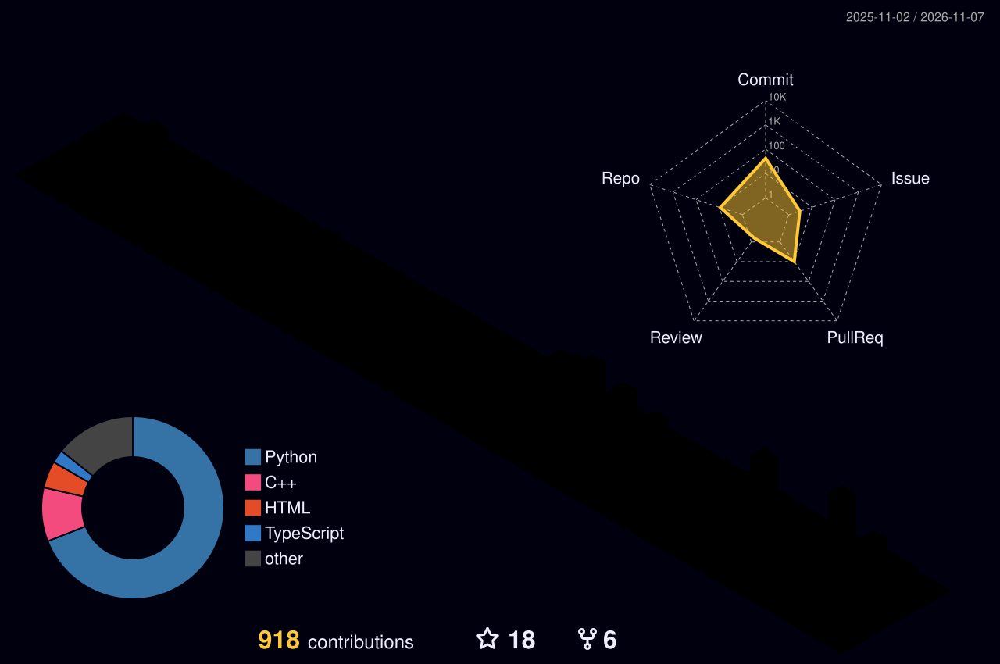

<!-- Header -->
<p align="center">
  
</p>

<p align="center">
  <a href="https://git.io/typing-svg">
    
  </a>
</p>

<p align="center">
  <a href="https://www.linkedin.com/in/jo%C3%A3o-pedro-siqueira-647b1a260/"></a>
  <a href="mailto:joaopedrosilvasiqueira1@gmail.com"></a>
  <a href="https://discord.com/users/johnpss"></a>
  
</p>

---

## 👨‍💻 About me

```cpp
struct Engineer {
    std::string name     = "João Pedro Siqueira";
    std::string role     = "Computer Engineering student";
    std::string school   = "UFCI";  
    std::string location = "Divinópolis - MG, Brazil 🇧🇷";

    std::vector<std::string> interests = {
        "algorithms & data structures",
        "bioinformatics / network medicine",
        "recommender systems",
        "distributed systems & DevOps",
        "computer architecture (FPGA / VHDL)"
    };

    std::string motto = "make it work, make it right, make it fast";
};
```

- 🧬 Building **[NetCanDrug](https://github.com/JohnPss/NetCanDrug)**, a network-medicine framework for drug repositioning in breast cancer
- ⚽ Shipping **[BoraPelada](https://borapelada-xi.vercel.app/)**: balanced team draws by algorithm, live match board, blind peer ratings and a monthly MVP ranking
- 🩺 Building **[IntegraDerme](https://integraderme-web.vercel.app)**, clinical management of skin lesions for the primary-care network of Divinópolis-MG

---

## 🛠️ Tech stack

<p align="center">
  
  <br/>
  
  <br/>
  
</p>

---

## 📊 GitHub stats

<!-- cool-readme:start -->
<p align="center">
<picture>
  <source media="(prefers-color-scheme: dark)" srcset="https://raw.githubusercontent.com/JohnPss/JohnPss/cards/summary-dark.svg">
  
</picture>
<picture>
  <source media="(prefers-color-scheme: dark)" srcset="https://raw.githubusercontent.com/JohnPss/JohnPss/cards/languages-dark.svg">
  
</picture>
</p>
<p align="center">
<picture>
  <source media="(prefers-color-scheme: dark)" srcset="https://raw.githubusercontent.com/JohnPss/JohnPss/cards/contributions-dark.svg">
  
</picture>
<picture>
  <source media="(prefers-color-scheme: dark)" srcset="https://raw.githubusercontent.com/JohnPss/JohnPss/cards/weekly-dark.svg">
  
</picture>
</p>
<!-- cool-readme:end -->

<p align="center">
  <picture>
    <source media="(prefers-color-scheme: dark)" srcset="https://raw.githubusercontent.com/JohnPss/JohnPss/output/profile-night-rainbow.svg"/>
    <source media="(prefers-color-scheme: light)" srcset="https://raw.githubusercontent.com/JohnPss/JohnPss/output/profile-season.svg"/>
    
  </picture>
</p>

<p align="center">
  <picture>
    <source media="(prefers-color-scheme: dark)" srcset="https://raw.githubusercontent.com/JohnPss/JohnPss/output/snake-dark.svg"/>
    <source media="(prefers-color-scheme: light)" srcset="https://raw.githubusercontent.com/JohnPss/JohnPss/output/snake.svg"/>
    
  </picture>
</p>

<!-- Footer -->

