  <picture>
    <source media="(prefers-color-scheme: dark)" srcset="https://raw.githubusercontent.com/JohnPss/JohnPss/assets/neofetch-dark.svg"/>
    <source media="(prefers-color-scheme: light)" srcset="https://raw.githubusercontent.com/JohnPss/JohnPss/assets/neofetch-light.svg"/>
    
  </picture>

  

### `$ ls ~/projects`

<table>
  <tr>
    <td width="33%" valign="top">
      <h4>🧬 <a href="https://github.com/JohnPss/NetCanDrug">NetCanDrug</a></h4>
      Network-medicine framework for <b>drug repositioning in breast cancer</b>: PPI topology, pathway dysregulation, gene expression and drug–target data, validated on TCGA-BRCA.
        
        
    </td>
    <td width="33%" valign="top">
      <h4>⚽ <a href="https://borapelada-xi.vercel.app/">BoraPelada</a></h4>
      Pickup soccer without arguments: <b>balanced team draws by algorithm</b>, live match board, blind peer ratings and a monthly MVP ranking.
        
        
    </td>
    <td width="33%" valign="top">
      <h4>🩺 <a href="https://integraderme-web.vercel.app">IntegraDerme</a></h4>
      <b>Clinical management of skin lesions</b> for the primary-care network of Divinópolis-MG.
        
        
    </td>
  </tr>
</table>

### `$ cat ~/.contributions | snake`

<picture>
  <source media="(prefers-color-scheme: dark)" srcset="https://raw.githubusercontent.com/JohnPss/JohnPss/assets/snake-dark.svg"/>
  <source media="(prefers-color-scheme: light)" srcset="https://raw.githubusercontent.com/JohnPss/JohnPss/assets/snake.svg"/>
  
</picture>

### `$ ping joao`

  
  
  

The card above is rendered by <a href="scripts/neofetch.py"><code>scripts/neofetch.py</code></a> and refreshed daily by GitHub Actions.
