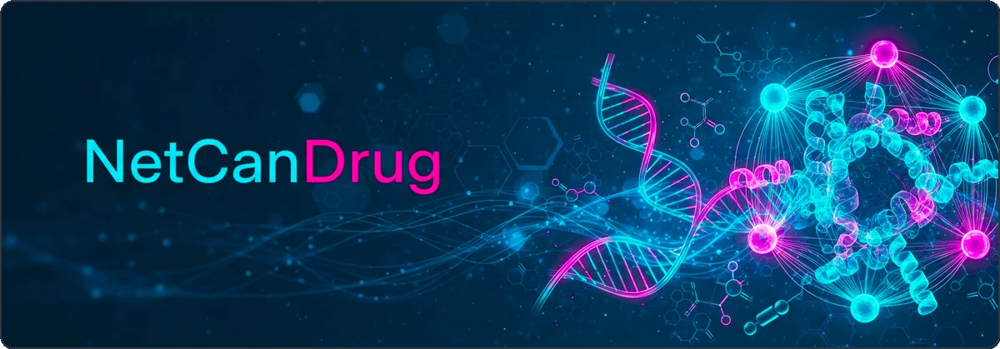
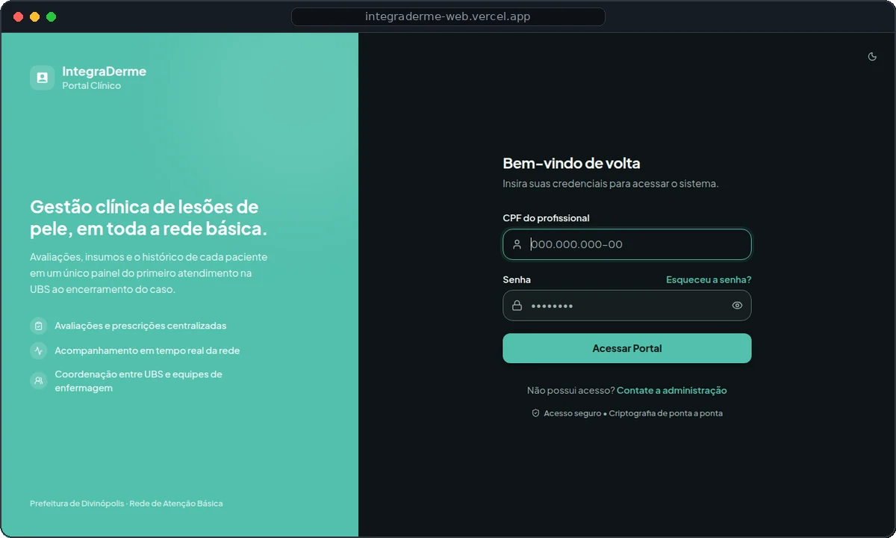

  
  
  

<table>
  <tr>
    <td colspan="2">
      
      <h3>🧬 <a href="https://github.com/JohnPss/NetCanDrug">NetCanDrug</a> · research</h3>
      Network-medicine framework for <b>drug repositioning in breast cancer</b>. It combines protein–protein interaction topology, pathway dysregulation, gene expression and drug–target data to rank compounds, and recovers FDA-approved therapies on TCGA-BRCA <i>without using clinical labels</i>.
        
      <code>Python</code> <code>R</code> <code>NetworkX</code> <code>igraph</code> <code>Bioconductor</code>
    </td>
  </tr>
  <tr>
    <td width="50%" valign="top">
      
      <h3>⚽ <a href="https://borapelada-xi.vercel.app/">BoraPelada</a> · product</h3>
      Pickup soccer without the arguments: <b>balanced team draws by algorithm</b>, live match board, blind peer ratings and a monthly MVP ranking.
        
      <code>Next.js</code> <code>TypeScript</code> <code>Postgres</code> <code>Tailwind</code>
    </td>
    <td width="50%" valign="top">
      
      <h3>🩺 <a href="https://integraderme-web.vercel.app">IntegraDerme</a> · product</h3>
      <b>Clinical management of skin lesions</b> across the primary-care network of Divinópolis-MG: assessments, supplies and each patient's history in one place.
        
      <code>FastAPI</code> <code>Python</code> <code>Docker</code>
    </td>
  </tr>
  <tr>
    <td width="50%" align="center"></td>
    <td width="50%" align="center"></td>
  </tr>
  <tr>
    <td colspan="2">
      <picture>
        <source media="(prefers-color-scheme: dark)" srcset="https://raw.githubusercontent.com/JohnPss/JohnPss/output/profile-night-rainbow.svg"/>
        <source media="(prefers-color-scheme: light)" srcset="https://raw.githubusercontent.com/JohnPss/JohnPss/output/profile-season.svg"/>
        
      </picture>
    </td>
  </tr>
</table>

  

